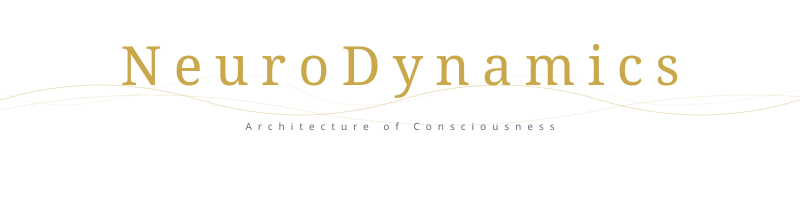
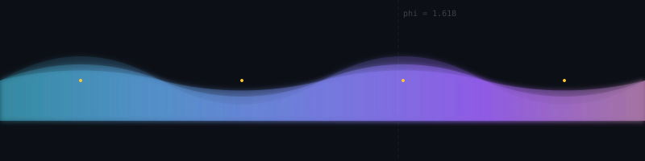

  

  
  

---

**NeuroDynamics Suite** — open-loop генератор нейроакустических сессий: бинауральные/монауральные биения, isochronic layers, пространственная модель и органический саунд-дизайн. Personal product-ready CLI → FLAC 24-bit / 44.1 kHz + CUE + session map.

## Что делает движок (факт)

*   **Binaural beats** с log-sweep носителя и частоты биения; опционально второй FocusMix-слой (body + cortex).
*   **Monaural AM**, синхронизированный со sweep бинаурала (двойной pathway).
*   **Isochronic soft-gate v2** + ASSR-80 с усиленным сглаживанием (меньше roughness).
*   **Open-loop дыхательная AM** (4–6 BPM, ramp, exhale bias) — без датчиков.
*   **HRTF** (аналитика Brown–Duda / Woodworth), Schumann stack, Lorenz-jitter биения, φ-layer, granular, formant, soft tube, reverb.
*   **Master chain:** pre-norm → Comfort EQ → soft ceiling → `block_gain`; continuous underbed; equal-power crossfade на близких несущих; structured quiet перед void/OBE.

## Научная рамка (честно)

Проект **вдохновлён** литературой по FFR / binaural beats, практиками в духе Monroe Hemi-Sync / Gateway Focus-лестницы и многослойным стеком (binaural + monaural + isochronic + beds). Это **не** клинически валидированный протокол и **не** доказательство изменения DMN, гиппокампального CFC или HRV.

| В коде | Корректная формулировка |
|--------|-------------------------|
| Lorenz на beat envelope | Детерминированный jitter частоты биения (~0.5–3 Hz), гипотеза «менее предсказуемого» паттерна |
| `apply_cfc` | Амплитудная модуляция gamma-слоя тета-синусом (упрощённый open-loop PAC), не измеренный hippocampal CFC |
| Respiratory AM | Фиксированный/рамповый open-loop pacing; не closed-loop HRV |
| φ-layer | Гармонический / геометрический слой носителя и биения |
| FocusMix | Dual-frequency stacking по мотивам Focus-10 (тело/delta + кора/alpha-beta), без EEG-подтверждения |
| `CHAKRA_ASCENT` 396–963 Hz | Нумерологическое соответствие (Puleo/Horowitz) + sound-healing традиция; не физическое свойство тканей/энергоцентров; символический/интенциональный слой |

Эффекты субъективны. Для бинаурала нужны **проводные** стерео-наушники. Рекомендуемая громкость **15–30%**. Не медицинское изделие.

## Dual-mode профили

| Режим | Профили | Характер |
|-------|---------|----------|
| **Permanent** | GENESIS, WALK, SLEEP, HEALER, ORACLE | ComfortEQ, мягкие iso/ASSR, quiet voids, breath ramps |
| **Sharp-safe** | WARRIOR | Выше энергия gamma/ASSR, soft-gate + ceiling, ComfortEQ только на descent |
| **Gateway Edge** | GATEWAY_EDGE (~31 мин) | F10→F12→F15→soft interrupt→F21 touch→seal |
| **Chakra** | CHAKRA_ASCENT (~37 мин) | 396→963 + elevation ladder + vowel formants (symbolic) |
| **Deep Dive PRO** | DEEP_DIVE (~120 мин) | F10→F21→F27+ adaptive drift · ночной · без чаш/bridges · gain ≤0.52 |

## Архитектура сессий

  

1. Soft FFR prime → фазы профиля → ambient bridges после длинных блоков  
2. Structured quiet перед void/OBE (Gateway-style internalization)  
3. Equal-power XF внутри одной несущей; fade-through-silence при большом скачке carrier  

## Протокол использования

*   **Оборудование:** только проводные наушники.  
*   **Громкость:** 15–30%. Звук должен оставаться комфортным часами (permanent).  
*   **Положение:** лёжа / полулёжа (SLEEP/HEALER/ORACLE/GATEWAY_EDGE/DEEP_DIVE); WARRIOR — сидя/стоя.  
*   **Регулярность:** глубокие профили — не чаще 1× / 48 ч; **GATEWAY_EDGE** — 1× / 1–2 нед; **DEEP_DIVE** — 1× / неделю; после SEAL — 10 мин тишины.

## Структура проекта

*   **`psychoacoustic/`** — DSP-ядро  
*   **`genesis_generator.py`** — TUI  
*   **`tests/`** — Pytest (DSP hygiene + profile smoke)  

`legacy_archive/` — личная история; не часть активного продукта.

---
**Author:** franklin-sys  
**Project:** NeuroDynamics Suite (2026)  
**Web:** [https://franklin-sys.vercel.app/](https://franklin-sys.vercel.app/)
